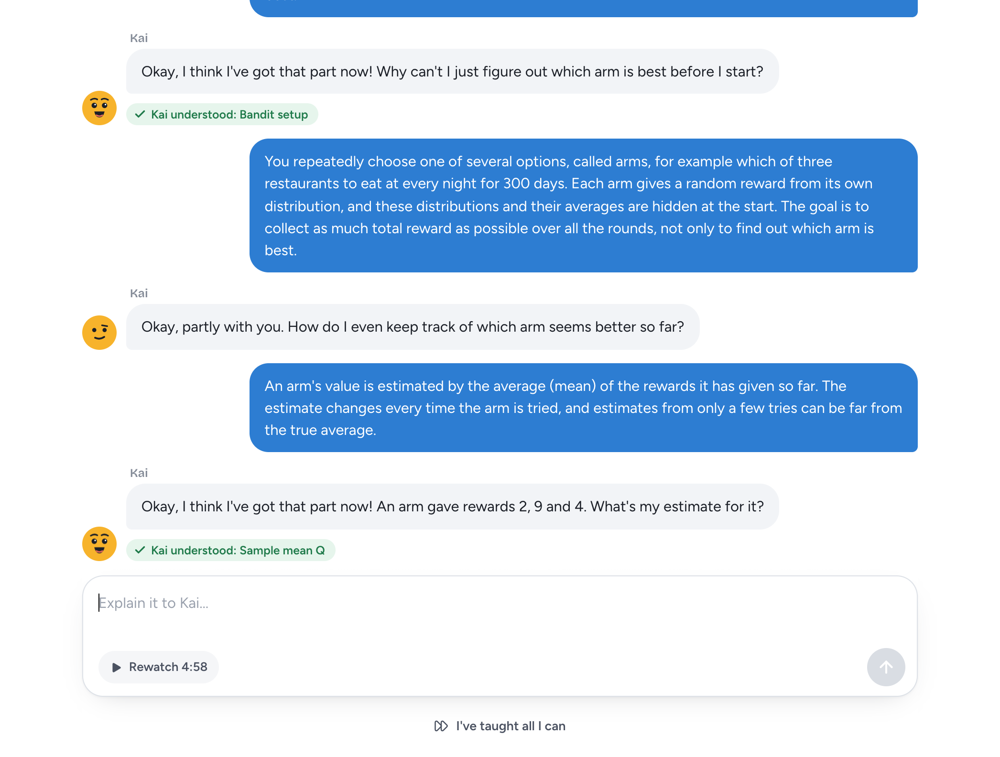
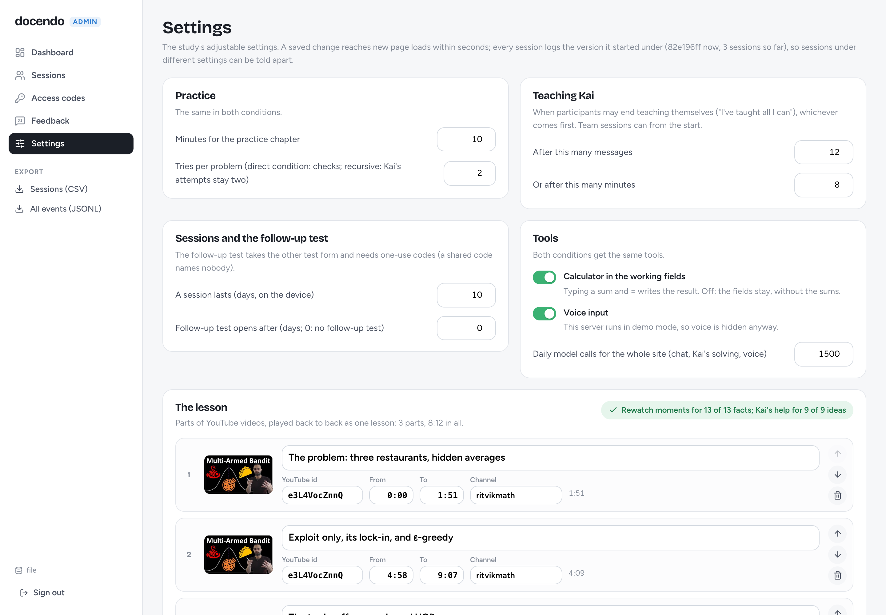

<h1>&nbsp;Docendo</h1>

> ***Docendo discimus***: by teaching, we learn.<br>
> Learn a topic by explaining it to Kai, an AI classmate who only knows what you tell it.

<br>

[](https://nextjs.org)
[](https://react.dev)
[](https://www.typescriptlang.org)
[](https://openrouter.ai)
[](https://vercel.com)
[](https://upstash.com)
[](https://vitest.dev)
[](https://www.epfl.ch)

**[A session](#a-session)** &nbsp;&nbsp; **[The study](#the-study)** &nbsp;&nbsp; **[How Kai works](#how-kai-works)** &nbsp;&nbsp; **[Running the study](#running-the-study)** &nbsp;&nbsp; **[Running it locally](#running-it-locally)** &nbsp;&nbsp; **[Credits](#credits)**


Docendo is a web app for learning a topic by teaching it. You watch a short lesson, then explain it to Kai, a classmate who missed the lecture and only knows what you tell it. Kai asks questions, gets confused when an explanation doesn't land, and says when it finally feels ready. A practice round and a final test show what stuck.

It is also the instrument for a small study on **learning by teaching** with an AI pupil. The current lesson is on **multi-armed bandits**; the topic can be swapped.

## Why teach a chatbot?

Explaining something to someone else is one of the more reliable ways to learn it. A tutor has to organise the material, notice the gaps in their own understanding, and answer questions they hadn't thought of. Research on *teachable agents* (Betty's Brain, SimStudent) adds a further effect: students learn more when they watch their pupil use what they taught, because the pupil's mistakes show them their own (Okita & Schwartz, 2013).

That only works if the pupil truly knows nothing beyond what it was taught. A language model asked to "act like a novice" tends to slip back into expert answers. Kai is built around that constraint: it keeps a notebook of what you told it, in your words and mistakes included, it may not use lesson terms you haven't introduced, and when it solves a problem the code checks that its notebook actually holds what the problem needs.

## The topic

A multi-armed bandit is a repeated choice between options whose average payoff you don't know: slot machines, restaurants, headlines on a website. Each round you pick one option and see only what that one gives you. The interesting part is the trade-off between *exploring* (trying options to learn about them) and *exploiting* (going with the best one so far).

After a session, a learner should be able to **predict which option greedy, ε-greedy and UCB pick next, and explain why greedy can lock onto a worse option while ε-greedy and UCB keep exploring**, each in its own way.

The lesson is about 8 minutes: three parts of two videos, played one after another as one lesson.

- [Multi-Armed Bandit: Data Science Concepts](https://www.youtube.com/watch?v=e3L4VocZnnQ) by ritvikmath: the restaurant problem (0:00–1:51), then exploit only, its lock-in and ε-greedy (4:58–9:07);
- [Multi-Armed Bandits Explained: Epsilon-Greedy vs UCB](https://www.youtube.com/watch?v=8CquWcViBfg) by DataMListic: the trade-off, ε-greedy and UCB (0:27–2:39).

The parts and their timings can be changed on the admin panel's Settings page.

## A session

About 42 minutes, in this order:

1. **Start.** An access code, and a consent checkbox: the study note says what is recorded, and Start stays off until it is ticked.
2. **Five quick questions** on what you already know (with "I don't know"), so learning can be measured against a starting point.
3. **Watch** the lesson. Chapters show each part's thumbnail and how much of it you've watched.
4. **Teach Kai.** Explain the ideas in your own words, typed or spoken (a microphone writes out what you say, live). Kai reacts to every answer and asks follow-up questions; when one of your explanations completes an idea, a small milestone appears under Kai's reply. If you're stuck on what Kai asks, a help button replays the right moment of the video, but only after you've had a go. Teaching ends when Kai feels ready, after 30 messages, or when you decide you've taught all you can.
5. **Practice:** two rounds of three problems, 10 minutes. What happens here depends on the study condition (below).
6. **Final test:** ten questions on new examples, first six to choose, then four to work out a number, each with a field for working (and a calculator, which the study can switch off).
7. **Six questions about the session**, before the score: effort, responsibility for Kai, how well you think you understood, how much practice helped, enjoyment, and what the practice's feedback was about.
8. **Results:** your score, explanations of the questions you missed first, the worked solutions of the practice problems, and a short feedback box.
9. **A follow-up test**, if the study runs one: some days later the same code (or the same device) opens a second test on the same ideas with different questions.

<table>
  <tr>
    <td width="50%"></td>
    <td width="50%"></td>
  </tr>
  <tr>
    <td align="center"><sub>Watch the lesson</sub></td>
    <td align="center"><sub>Teach Kai: reactions and milestones</sub></td>
  </tr>
</table>

## The study

Docendo replicates the comparison in Okita and Schwartz's (2013) second experiment: **recursive** against **direct** feedback.

- **Direct feedback:** you solve the practice problems yourself, a first try and one retry each, and a light says whether your answer is right.
- **Recursive feedback:** Kai solves them, from what you taught it. You read its reasoning step by step beside its notebook (your words, in its hand), say whether you think it's right, then see the light. If Kai is wrong you write one correction; Kai notes what it takes from it (the notebook strikes out and rewrites in a second ink) and tries again.


**Everything else is the same in both conditions:** the lesson, teaching Kai, the practice problems and time, the tools (Rewatch, the calculator, voice input), the light's feedback, the test, the questions after it. Kai can only be right when its notebook holds every fact the problem needs, explained correctly, so its answers reflect the teaching, not the language model's own knowledge.

**Measures.** The final test (and the follow-up test) against the pretest. The test has two parallel forms, A and B, item for item the same idea and difficulty in different settings; each participant takes one at the end of the session and the other in the follow-up, and the order is balanced within each condition. A participant's code decides their condition (in balanced blocks of four). The questions after the test include a manipulation check: whether the practice's feedback felt like it was about yourself or about Kai.

**Process data.** Every chat message with the judge's verdicts and Kai's move, Kai's notebook, practice tries and Kai's attempts, the learner's calls on Kai's answers, video playback, timings, typing, pasting and dictation, the test answers with their working, the survey and the feedback. Each session records the settings version it ran under.

## How Kai works

The lesson is a small knowledge graph: 9 ideas (greedy, lock-in, ε-greedy, the UCB bonus, …), each with two to four facts and the ideas it builds on, inside a larger 19-idea graph of the topic. On every message:

1. A **judge** (a language model) decides which facts your message explains, and how well. Informal wording and examples count. It has to quote your own words, or the verdict is dropped.
2. Those facts go into **Kai's notebook**, in your words. So do mistakes: the judge also records any wrong belief you state, quoting you, and Kai believes it until you correct it.
3. A small **policy** picks Kai's next move. Kai keeps one beginner's question for each fact it needs and asks about one missing fact at a time. When an answer only partly lands, it asks once more, then moves on. When an idea is complete, Kai says so, checks it with a "why" or "what if" question or voices a common misconception for you to correct, then moves on. Every message from Kai ends with one clear question.
4. A **writer** (a language model) phrases Kai's reply. It sees only the notebook and the chosen move, never the lesson.
5. A **term check** blocks lesson terms you haven't used yet. A leaking reply is rewritten once and otherwise replaced with a safe question.

**Understanding** is counted over the 13 facts the lesson covers: an explained fact counts 1, a partly explained one ½. Kai feels ready at 80%, or at 50% once you've taught for 8 minutes, as long as at least one idea is fully explained.

**Kai's mind** shows the graph live: which ideas are untaught, started, done or set aside, what changed since you last looked, and, per idea, the questions Kai has asked with your answers. Questions Kai hasn't asked yet appear only as a count, so the view never gives the lesson away.

**When Kai solves a problem** (recursive feedback), the code first checks its notebook against the facts the problem needs. If one is missing or wrong, Kai reasons from a beginner's wrong rule for it, so its mistake follows from its own steps. A language model writes the steps from the numbered notebook only, citing the lines it used.

## Running the study

Everything the team needs while the study runs is on the **admin panel** at `/admin` (after setting `ADMIN_PASSWORD`).



- **Dashboard:** sessions per day and how far people get, by condition; the score distribution in each condition, pretest against final test, and a clearly labelled preliminary comparison (difference with a 95% interval and effect size); condition × test form balance; minutes per chapter; how hard each practice problem and test question is in each condition; the answers to the questions after the test, with the manipulation check; teaching statistics; sessions whose data may need a second look (skipped the video, barely taught, rushed the test, long away from the tab); the follow-up test; the latest feedback.
- **Sessions:** every session in detail: the chat with the judge's verdicts, Kai's attempts or the learner's tries, the test, the feedback, every event.
- **Access codes:** made in bulk, each with a condition (direct, recursive, or random in balanced blocks) and a number of uses. The follow-up test needs one-use codes.
- **Settings:** practice minutes and tries, when participants may stop teaching, how long a session lasts, the follow-up test's delay (or none), the calculator and voice input, the daily model budget, and the lesson's video parts with their timings. A change is checked (for example, how much of the lesson's help still falls inside the edited parts), versioned and logged, and every new session records the version it started under. What defines Kai or the test's structure is shown there read-only: it changes in code, with a reason, not mid-study.
- **Export:** sessions as CSV, every event as JSONL (`pnpm events export` writes the full set of tables).

The panel's numbers are descriptive. The planned analysis runs on the exported data.

## Running it locally

You need Node.js 22 or newer and pnpm.

```bash
pnpm install
pnpm dev
```

Open http://localhost:3000. Without an API key the app runs in **demo mode**: everything works, but Kai's replies come from a simple offline judge and scripted lines.

To use real models, create a `.env` file (see `.env.example`):

| Variable | |
|---|---|
| `OPENROUTER_API_KEY` | An [OpenRouter](https://openrouter.ai) key. Without it, demo mode. Give it a credit limit. |
| `SESSION_SECRET` | A random string that signs session tokens (`openssl rand -hex 32`). Required in production. |
| `ADMIN_PASSWORD` | Turns on the admin panel (10 characters or more). |
| `UPSTASH_REDIS_REST_URL`, `UPSTASH_REDIS_REST_TOKEN` | Required for the study: the research log, access codes, settings and participant records, and shared rate limits. |
| `ACCESS_CODE` | Optional: one shared code for the team and demos (direct condition, with a switch to see both). |
| `CODE_SECRET` | Optional: the older participant codes made with `pnpm codes`, where the code itself carries the condition. |
| `SESSION_DAYS`, `DELAYED_TEST_DAYS`, `PRACTICE_MINUTES`, `PRACTICE_TRIES` | Defaults for what the Settings page can change later. |

The rate limits and model names can also be changed; `.env.example` lists them all.

```bash
pnpm build && pnpm start   # production build
pnpm test                  # unit tests
pnpm build && pnpm e2e     # a whole session clicked through in Chrome, on its own safe demo server; screenshots in .e2e/
pnpm chat --demo           # talk to Kai in the terminal and see the judge's verdicts and Kai's moves
pnpm events export         # the research log as JSONL and CSV tables in data/
pnpm eval:judge            # the judge on labelled messages (uses real credits); also eval:solver, eval:chat
```

### Deploying

Docendo is a standard Next.js app and runs on Vercel or any Node host. Set `SESSION_SECRET`, `ADMIN_PASSWORD` and, for a real Kai, `OPENROUTER_API_KEY`, and add Upstash Redis (Vercel → Storage → Marketplace). Then sign in to `/admin`, check the Settings page, and make the participants' codes.

### Security and privacy

The API keys never leave the server. The browser only talks to Docendo's own endpoints, which require a signed session token, validate and size-cap every request, refuse other sites, and are rate-limited per learner, per network and per day. Test answers, practice solutions (until the test is graded), the test questions of the other form, the lesson's facts and the participant's condition are never sent to the browser; an automatic check scans the built app and the rendered pages for them. Sessions are identified by a random id and a code's id, never a name or the code. Voice recordings are written out and not kept. The exported data holds what participants wrote, so it stays out of git (`data/`, `.data/`).

### Changing the lesson

Each topic lives in `topics/<name>/`: the sources and the lesson slice in `topic.yaml`, the knowledge graph (`graph.draft.json`), which facts the videos state (`coverage.json`), Kai's extra lines (`questions.json`), the pretest, the practice problems, the two test forms and the questions after the test. For bandits these were written by hand. Then:

```bash
pnpm content ingest bandits     # fetch the videos' captions
pnpm content validate bandits   # check the graph, and that Kai's questions don't give away lesson terms
pnpm content bundle bandits     # build topics/bandits/bundle.json for the app
```

For a new topic, an authoring pipeline in `content/authoring/` can draft the graph with a language model, find where each fact is covered in the sources, check coverage, and write a review page for the team. It isn't part of the study's flow.

## Project structure

```
app/          pages and API routes (Next.js), the admin panel
components/   interface; components/admin/ the panel's charts and forms
engine/       Kai: judge, notebook, policy, writer, term check, solver (pure TypeScript, unit-tested)
content/      content tools: ingest, validate, bundle, practice checking, graph layout; authoring/
topics/       lessons: sources, knowledge graph, questions, practice, tests, survey
lib/          settings, analytics; lib/server/ configuration, sessions, limits, storage; lib/client/ browser storage, voice
tests/        unit tests
scripts/      browser walkthrough, terminal chat, model evals, participant codes, data export
```

## Credits

Made for CS-411 Digital Education at EPFL by Andrii Negrub, Phil Gustke and Rafael Cruz.

Lesson videos by [ritvikmath](https://www.youtube.com/@ritvikmath) and [DataMListic](https://www.youtube.com/@datamlistic). The knowledge graph also draws on Sutton & Barto, *Reinforcement Learning: An Introduction* (ch. 2), and Slivkins, *Introduction to Multi-Armed Bandits* (ch. 1).

Okita, S. Y., & Schwartz, D. L. (2013). Learning by teaching human pupils and teachable agents: The importance of recursive feedback. *Journal of the Learning Sciences, 22*(3), 375–412.

### Use of AI

In line with the CS-411 rules on generative AI, we declare that Docendo was built with the help of an AI coding agent ([Claude Code](https://www.anthropic.com/claude-code) by Anthropic). The agent assisted with background research, the code, the knowledge graph, the exercises and this README. The team set the direction and the requirements, reviewed and tested what the agent produced, and takes responsibility for the result.

Kai itself runs on language models, through OpenRouter, as does voice input. That is part of the product, not of how it was built.

---

<sub>&nbsp; Made with patience and a lot of questions from Kai. EPFL, 2026</sub>
