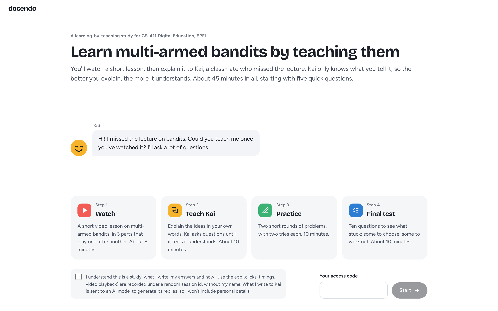
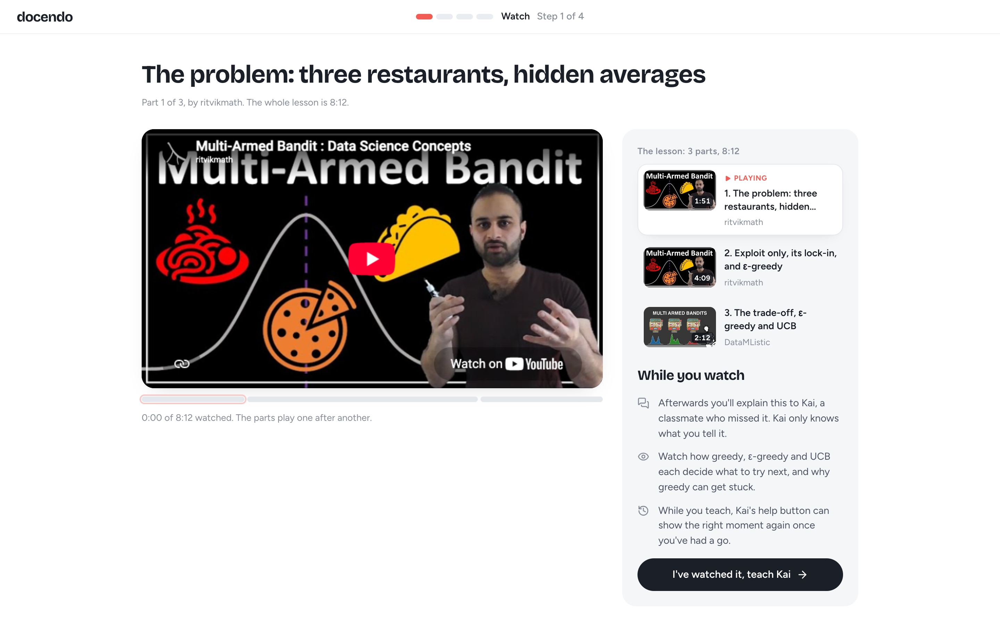
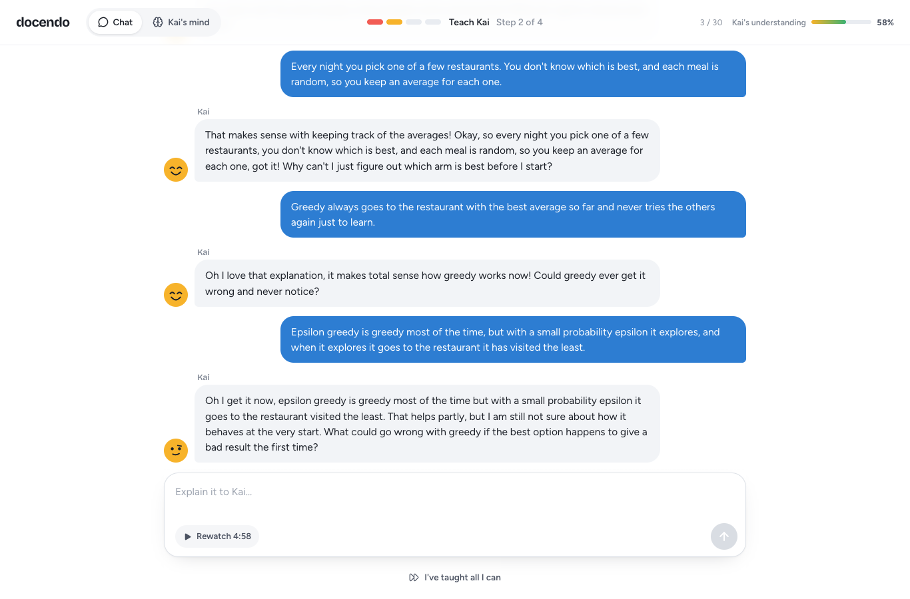
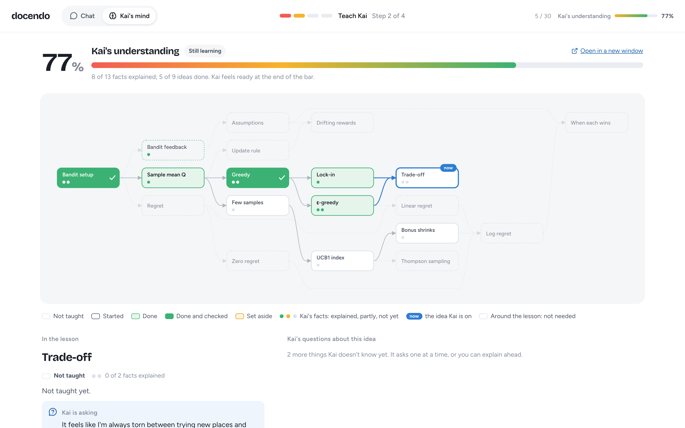
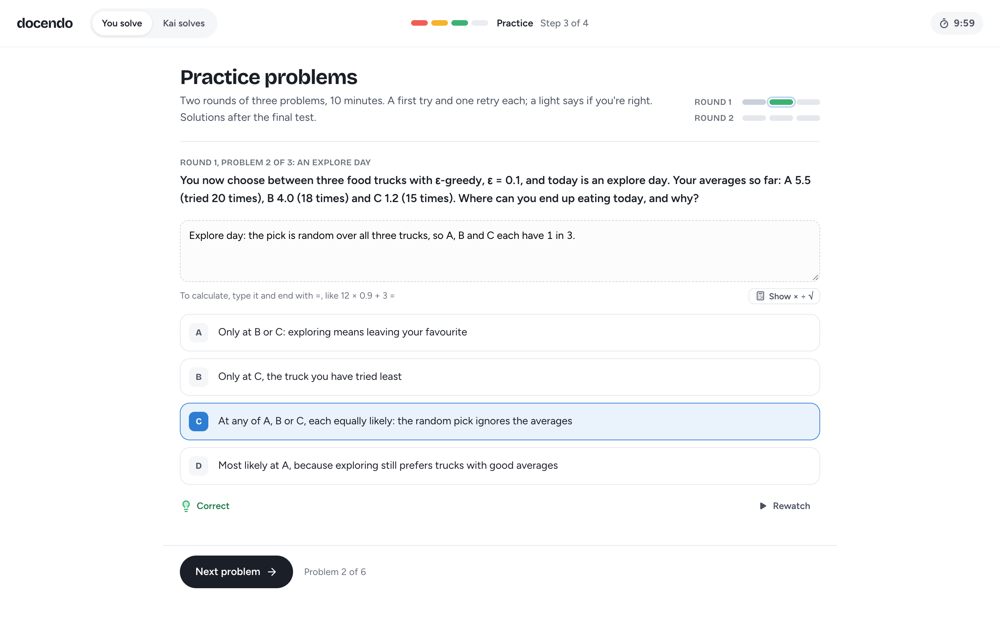
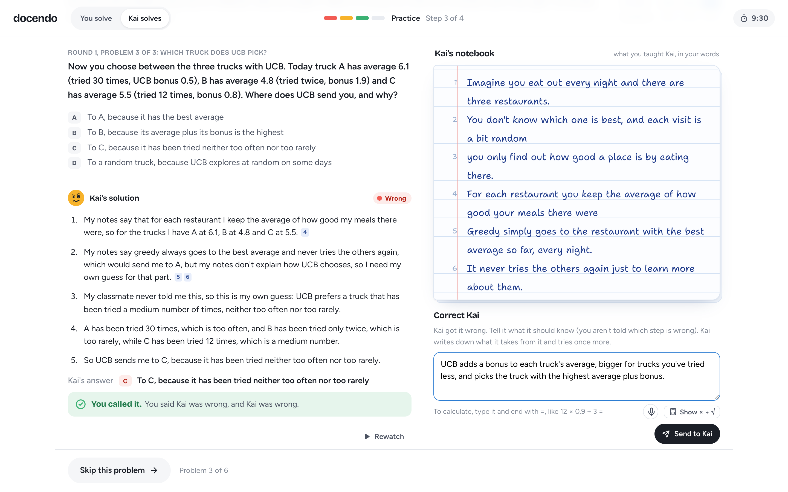
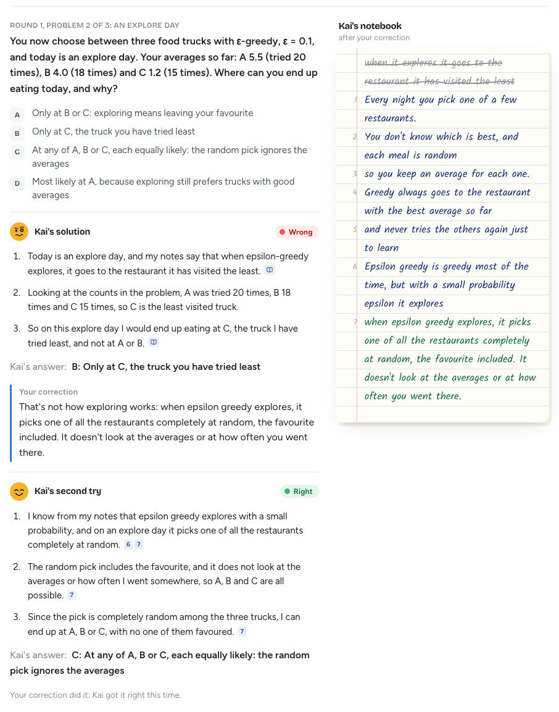
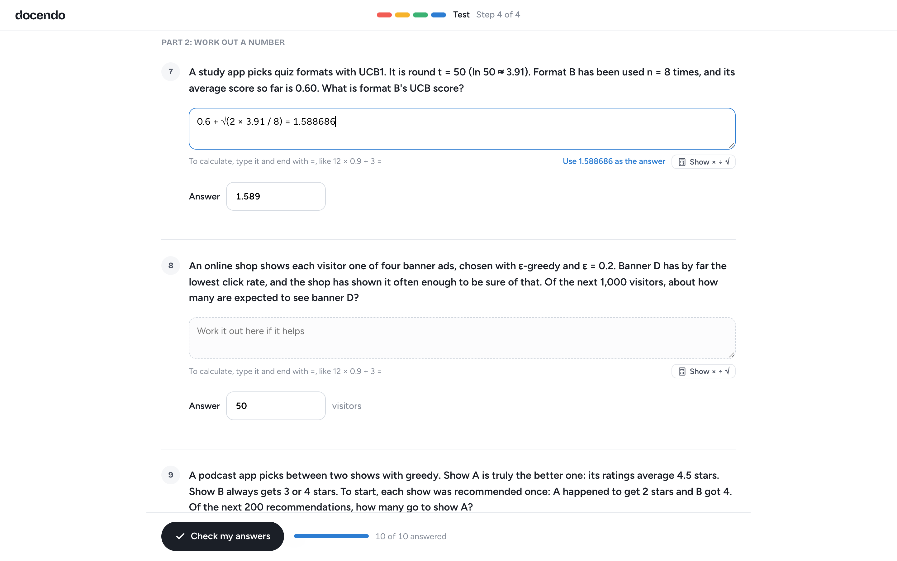
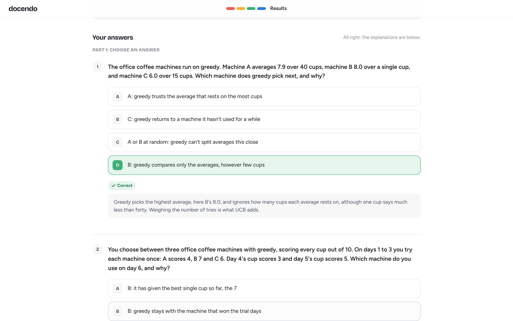
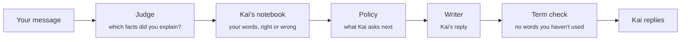

<h1>&nbsp;Docendo</h1>

> ***Docendo discimus***: by teaching, we learn.<br>
> Learn a topic by explaining it to Kai, an AI classmate who only knows what you tell it.

<br>

[](https://nextjs.org)
[](https://react.dev)
[](https://www.typescriptlang.org)
[](https://openrouter.ai)
[](https://vercel.com)
[](https://upstash.com)
[](https://vitest.dev)
[](https://www.epfl.ch)

**[Live app](https://docendo-jade.vercel.app)** &nbsp;&nbsp; **[Features](#features)** &nbsp;&nbsp; **[A session](#a-session-step-by-step)** &nbsp;&nbsp; **[How Kai works](#how-kai-works)** &nbsp;&nbsp; **[The study](#the-study)** &nbsp;&nbsp; **[Run it yourself](#run-it-yourself)** &nbsp;&nbsp; **[Credits](#credits)**



Explaining something to someone else is one of the most reliable ways to understand it yourself. You have to put the ideas in order, find words for them, and notice the gaps when the other person doesn't follow. Docendo turns that into a forty-minute session: you watch a short lesson, teach it to **Kai**, practise, and take a test.

Kai is not a chatbot that already knows the answer. It is a classmate who missed the lecture. It writes down what you say, in your words, asks about what it still doesn't get, and believes your mistakes along with everything else. When Kai later works through a problem, all it has is that notebook.

The current lesson is about **multi-armed bandits**: how greedy, ε-greedy and UCB decide what to try next, and why greedy can get stuck. The app was built for a small study in EPFL's CS-411 Digital Education course.

## Features

**Learning with Kai**
- **A classmate who only knows what you said.** Every point Kai learns is checked against your exact words, and its notebook keeps them: each note one statement in your own words, with at most a few of Kai's words (in a lighter ink) where a short answer needs context.
- **Questions, not lectures.** Kai asks one beginner's question at a time, says when something clicks, and now and then voices a typical wrong idea for you to catch.
- **Kai's mind.** A live map of the lesson's ideas showing how far Kai has got with each, without ever giving away an answer.
- **Practice that shows your gaps.** Kai solves problems from its notebook alone. Where you left a gap, it reasons from a beginner's wrong rule, so its mistakes point at what it wasn't taught.
- **Help at the right moment.** A card replays the part of the video that covers Kai's question, once you've had a go yourself.
- **Voice or keyboard.** Speak your explanation and watch it appear as you talk; edit before sending.
- **A notes calculator.** Type a sum ending in `=` in any working field, and the result is written in, so the arithmetic never gets in the way.

**Built for a study**
- **Two conditions, fairly assigned.** Practise yourself (direct feedback) or watch Kai practise (recursive feedback), from each participant's own code, in balanced blocks.
- **Parallel test forms and a follow-up test.** Two matched forms, alternated within each condition, and an optional delayed test days later with the other form.
- **A short pretest and questions after the test**, including a check that the two kinds of practice felt different the way they should.
- **Everything is recorded** (with consent, never names or codes) and exports to CSV for the analysis.

**Built to be reused**
- **Any topic.** A topic is a folder of files (videos, ideas, questions, problems, tests, wording), validated before it ships; nothing about bandits is written into the app.
- **Steps that can be switched.** The pretest, the video and the practice can each be left out; every page and number follows.
- **Works offline.** Without a model key the whole app runs on scripted stand-ins, marked as a demo.
- **Accessible and light.** Readable contrast, keyboard use throughout, phone layouts, and a small browser download.

## A session, step by step

You start on the page above with an access code and five quick background questions. Then come four steps, shown as coloured bars at the top of every page.

### 1. Watch



An 8-minute lesson stitched from three parts of two YouTube videos, playing one after another in a single player. The side panel lists the parts and says what comes next: you'll be explaining this to someone.

### 2. Teach Kai



A chat, in your own words. Kai asks one beginner's question at a time, reacts when something clicks, and now and then voices a wrong guess for you to catch. If you're stuck, a help card can take you back to the right moment of the video, once you've had a go yourself. Kai says when it feels ready; there is no script to follow.



**Kai's mind** shows what Kai has understood so far: the ideas of the lesson as a map, each one marked not taught, started, done or set aside, with Kai's open question beside it. It shows Kai's state, never the answers: a question Kai hasn't asked yet is only a count.

### 3. Practice

Six problems in two rounds of three, ten minutes in all. Each round has one problem on each strategy, and the second round puts the same ideas in a new setting. How you practise depends on your study group.

**You solve.** You pick an answer, with room to work it out, and a light says whether you're right. A wrong first answer gets one more try.



**Kai solves.** Kai works the problem out step by step from its notebook, citing the notes each step uses. Before the light comes on, you call it: is Kai right? If Kai is wrong, you aren't told which step failed. You write one correction, Kai adds it to its notebook, and tries again.





Here Kai was never taught UCB, so its first try rests on a beginner's guess about it. After one sentence of correction, the new note appears in a second ink, and the second try uses it (the note lights up while you point at a step) and gets it right.

### 4. Final test



Ten questions in settings the practice didn't use: six to choose and four to work out. In the working field, a sum ending in `=` is worked out for you, so the test measures the ideas rather than the arithmetic.

### Results



Your score, every answer with an explanation of why it's right, and the worked solutions to the practice problems. Kai's mind opens again here, so you can look back at what you taught.

## How Kai works

Kai is a few small parts with a clear split of work: language models do the judging and the talking, plain code decides what Kai knows.



- **The judge** reads each message against the lesson's facts and returns which ones you explained, partly explained or got wrong. Every verdict must quote you word for word; code throws out any it can't find in your message.
- **The notebook** keeps only your quoted words, mistakes included. That is all Kai knows.
- **The policy** is ordinary code. It picks Kai's next move (ask about a missing fact, voice a common misconception, check an idea from a new angle, answer a question you asked) and decides when Kai is ready.
- **The writer** turns that move into Kai's message, in a beginner's voice. It never sees the lesson, only the notebook and the chat. A check then makes sure Kai doesn't use a technical term you haven't used yet.
- **Solving** follows the same rule. Kai can only get a problem right if its notebook holds every fact the problem needs, correctly explained, and code enforces that. Where a fact is missing, Kai reasons from a typical beginner's wrong rule, so a wrong answer follows from its own steps rather than being swapped in at the end.

Without an API key, every model part has an offline stand-in, so the whole app runs in a demo mode.

## The study

Docendo replicates a classic finding with a modern tutee. Okita and Schwartz (2013) found that students who taught a pupil learned more when they then **watched the pupil solve problems** than when they solved the problems themselves. Seeing someone use your explanation, and fail where you left a gap, is feedback on your own understanding: they called it *recursive feedback*.

Here both groups watch the same lesson and teach Kai the same way. Only the practice differs: one group solves the problems themselves (direct feedback), the other watches Kai solve them from what it was taught (recursive feedback). The final test compares the two. Each participant's access code assigns their group, in balanced blocks.

## Run it yourself

You need Node 22 or newer and [pnpm](https://pnpm.io).

```bash
git clone https://github.com/0LuminaX0/docendo.git
cd docendo
pnpm install
pnpm dev
```

Open http://localhost:3000. With no configuration Kai runs in demo mode (scripted replies, marked with a badge) and every step works.

For the real Kai, copy `.env.example` to `.env` and fill in an [OpenRouter](https://openrouter.ai) key, a session secret and a code to start with:

```bash
OPENROUTER_API_KEY=sk-or-...
SESSION_SECRET=...      # openssl rand -hex 32
ACCESS_CODE=...         # what you type on the start page
```

A session costs a few cents in model calls; give the key a credit limit on OpenRouter. The other options are described in [.env.example](.env.example).

To deploy, import the repository into [Vercel](https://vercel.com) and add the same variables. Keys stay on the server: the browser only talks to the app's own API.

### Tests and tools

```bash
pnpm test                   # unit tests: Kai's engine, the content, the practice and test keys
pnpm typecheck
pnpm build && pnpm e2e      # a whole session in a headless browser, in demo mode
pnpm chat --demo            # talk to Kai in the terminal and see the judge's verdicts
pnpm build && pnpm shots    # retake the screenshots in this README
```

### A different topic

Nothing about bandits is built into the app: a topic is a pack of files in its own folder, like [topics/bandits/](topics/bandits). A pack holds the videos and their timings, the map of ideas with Kai's questions and misconceptions, the practice problems, the test forms, the questions before and after, and the words participants see (`copy.json`). To add one:

1. Write its files in `topics/<slug>/`.
2. Run `pnpm content validate <slug>`. It checks the whole pack (for example, that no question Kai asks uses a term it shouldn't know yet, and that the test forms match), and `pnpm content bundle <slug>` builds what the app reads.
3. Add one line for it in [lib/server/topics.ts](lib/server/topics.ts).

From then on, running a study on that topic is a setting, not a code change.

## Project layout

| Folder | What's in it |
| --- | --- |
| [app/](app) | Pages and API routes (Next.js App Router) |
| [components/](components) | The interface: chat, Kai's mind, practice, test |
| [engine/tutor/](engine/tutor) | Kai: judge, policy, writer, solver. Plain TypeScript, no framework |
| [content/](content) | Validating and bundling a topic, the layout of Kai's mind |
| [topics/bandits/](topics/bandits) | The lesson, written by hand |
| [lib/](lib) | Server helpers (sessions, limits, storage) and browser helpers |
| [scripts/](scripts) | Terminal chat, model evaluations, end-to-end test, screenshots |
| [tests/](tests) | Unit tests |

Built with Next.js 16, React 19, TypeScript and zod. Models run through OpenRouter: Gemini Flash Lite judges and writes Kai's messages, Claude Haiku solves the practice problems. Both were chosen by comparing models on labelled examples (`pnpm eval:judge`, `pnpm eval:solver`).

## Credits

Made for CS-411 Digital Education at EPFL by Andrii Negrub, Phil Gustke and Rafael Cruz. The milestone report is in [report/](report).

Lesson videos by [ritvikmath](https://www.youtube.com/@ritvikmath) and [DataMListic](https://www.youtube.com/@datamlistic). The map of ideas also draws on Sutton & Barto, *Reinforcement Learning: An Introduction* (ch. 2), and Slivkins, *Introduction to Multi-Armed Bandits* (ch. 1).

Okita, S. Y., & Schwartz, D. L. (2013). Learning by teaching human pupils and teachable agents: The importance of recursive feedback. *Journal of the Learning Sciences, 22*(3), 375–412. https://doi.org/10.1080/10508406.2013.807263

### Use of AI

In line with the CS-411 rules on generative AI, we declare that Docendo was built with the help of an AI coding agent ([Claude Code](https://www.anthropic.com/claude-code) by Anthropic). The agent assisted with background research, the code, the map of ideas, the exercises and this README. The team set the direction and the requirements, reviewed and tested what the agent produced, and takes responsibility for the result.

Kai itself runs on language models through OpenRouter, as does voice input. That is part of the product, not of how it was built.

---

<sub>&nbsp; Made with patience and a lot of questions from Kai. EPFL, 2026</sub>
